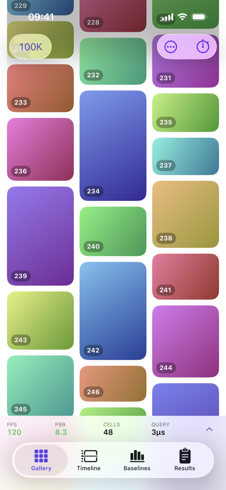
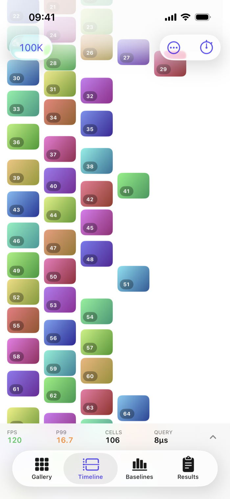
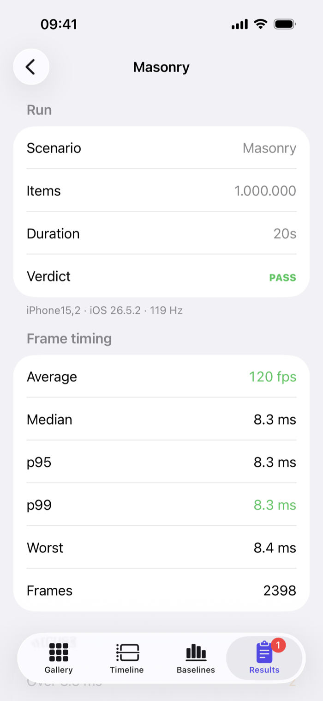
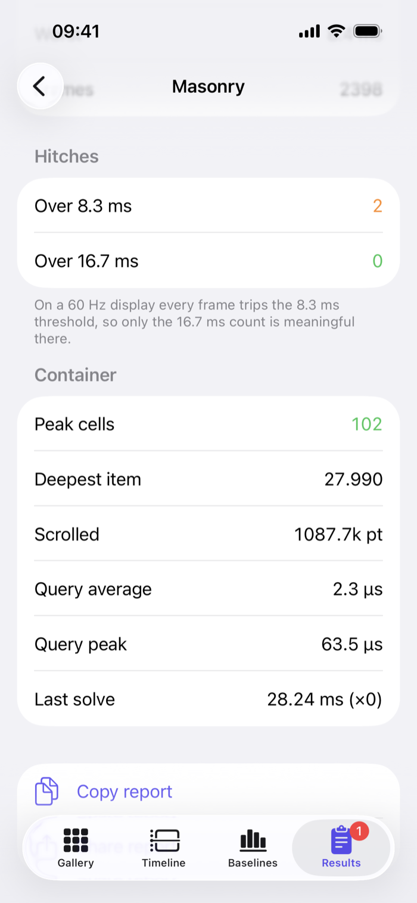

# LazyLayoutKit

[](https://github.com/Dave861/LazyLayoutKit/actions/workflows/ci.yml)
[](https://swiftpackageindex.com/Dave861/LazyLayoutKit)
[](https://swiftpackageindex.com/Dave861/LazyLayoutKit)

**You know `LazyVStack`, `LazyHStack` and `LazyVGrid`. Meet their cousin, one that lets you write the layout yourself.**

<p align="center">
  
</p>

Masonry, timelines, calendars, boards. Any layout you can describe, with SwiftUI building only the views that are actually on screen.

```swift
LazyLayoutView(photos, layout: MasonryLayout(columns: 3)) { photo in
    .aspectRatio(photo.width / photo.height)   // layout input — no view built
} content: { photo in
    PhotoCell(photo)                           // called only when on screen
}
```

## Why this exists

SwiftUI makes you pick one:

- [`Layout`](https://developer.apple.com/documentation/swiftui/layout) gives you any geometry you like, but it's **eager**. It measures every subview, so it falls over a few thousand items in.
- `LazyVStack` and friends are lazy, but their geometry is **fixed** — a vertical run, or a uniform grid.

There's nothing in between. And in between is where photo grids, feeds, calendars and boards live.

This isn't an oversight on Apple's part, it's a consequence. `Layout` asks each subview how big it wants to be, and you can't ask a view that hasn't been built. Measurement-driven layout and laziness pull in opposite directions.

Asked at the [WWDC26 SwiftUI Group Lab](https://developer.apple.com/videos/play/wwdc2026/8006/) whether custom layouts can be lazy, Apple's answer was: not today, `Layout` is eager-only, file a Feedback.

**So this package takes a different approach.** Tell it your item sizes up front — an aspect ratio, a date range, a duration — and layout becomes arithmetic. Arithmetic over a million items takes milliseconds and builds nothing. Only the frames intersecting your viewport ever become views.

That is the trade, and it is worth being explicit about it. You give up content that sizes itself — self-sizing text, mainly. You get arbitrary geometry that stays at 120 fps whether the collection holds a thousand items or a million.

## How it works

The layout function never sees a view. That's the entire idea.

```swift
public protocol LazyLayoutAlgorithm: Equatable, Sendable {
    associatedtype Item: Equatable & Sendable
    func layout(items: [Item], containerWidth: Double) -> LazyLayoutResult
}
```

`Item` is an associated type on purpose. Masonry wants an aspect ratio; a timeline wants a start and a duration; a calendar wants a date range. Pinning that to "height" would have made this a masonry library wearing a general name.

**Visibility** comes from a uniform bucket index built over whatever frames your layout produced — compressed-sparse-row, contiguous, no per-bucket hashing. It assumes nothing about structure, so your frames may overlap, arrive unordered, or use negative coordinates. Items spanning many buckets go on a separate oversized list rather than being copied into each one, which keeps worst-case memory linear.

**Scroll position** is anchored on your item identity, never on index. Insert one item at the front and every index shifts — anchor by index and you'd silently be holding a different item still.

## Two layouts in the box

**`MasonryLayout`** — fixed columns, each item dropped into whichever is shortest.

**`TimelineLayout`** — intervals on a vertical time axis, overlapping ones split into lanes.

Timeline is there to keep the protocol honest. Its items overlap vertically and its frames aren't monotonic in y in item order, so anything that had quietly assumed masonry's shape breaks on it. There's a test asserting exactly that.

<p align="center">
  
</p>

Both are written against the same public protocol you would use — about 60 and 90 lines each. Writing your own is the point.

## Writing your own layout

Return one frame per item and a total height. That is the entire obligation.

```swift
/// Wraps chips into rows, like a tag cloud.
struct ChipFlowLayout: LazyLayoutAlgorithm {
    struct Chip: Equatable, Sendable {
        var width: Double
        var height: Double
    }

    var spacing: Double = 8

    func layout(items: [Chip], containerWidth: Double) -> LazyLayoutResult {
        var frames: [LayoutRect] = []
        frames.reserveCapacity(items.count)

        var x = 0.0, y = 0.0, rowHeight = 0.0
        for chip in items {
            if x > 0, x + chip.width > containerWidth {   // wrap
                x = 0
                y += rowHeight + spacing
                rowHeight = 0
            }
            frames.append(LayoutRect(x: x, y: y, width: chip.width, height: chip.height))
            x += chip.width + spacing
            rowHeight = max(rowHeight, chip.height)
        }
        return LazyLayoutResult(frames: frames, contentHeight: y + rowHeight)
    }
}
```

No views, no measurement, no `GeometryReader` — just arithmetic over data you already have. Hand it to `LazyLayoutView` and it virtualizes for free:

```swift
LazyLayoutView(tags, layout: ChipFlowLayout()) { tag in
    .init(width: tag.estimatedWidth, height: 32)
} content: { tag in
    TagChip(tag)
}
```

Your frames can overlap, arrive in any order, and use negative coordinates. The visibility index assumes none of it. (This example is compiled by the test suite, so it cannot rot.)

## Install

iOS 18 · macOS 15. Built on `ScrollGeometry` / `onScrollGeometryChange`. 

```swift
.package(url: "https://github.com/Dave861/LazyLayoutKit.git", from: "0.1.0")
```

## Is it fast?

Measured on an **iPhone 14 Pro (A16), iOS 26.5.2, Release**, running the shipping container and index:

| | 100,000 items | 1,000,000 items |
|---|---|---|
| Sustained scroll | 120 fps, 8.34 ms p99, **zero frames over 16.7 ms** | 120 fps, 8.34 ms p99, **zero frames over 16.7 ms** |
| Visibility query | **2.1 µs** average | **2.0 µs** average |
| Cells materialized, any depth | 54 | 54 |
| Full re-solve on width change | 4.7–5.1 ms | — |

<p align="center">
  
  
</p>

<p align="center"><em>A recorded twenty-second run over a million items, from the demo app in this repo.</em></p>

The query staying **flat from 100k to 1M on device** is the property the design exists to produce: a viewport maps to a small bucket range, then the index walks contiguous entries. Cost follows window occupancy, not collection size. A layout where most items span many buckets can still degrade to a linear scan, still correct, just not fast.

Apple's `LazyVStack` over the same 100,000 items also managed 120 fps, the same 8.34 ms p99, and zero visible hitches. Read that as *generality cost us very little against a simpler container*, not a claim to be faster. It's one run each, over different content.

<details>
<summary><strong>What I learnt from measuring</strong></summary>

**A desktop benchmark can't predict a phone for memory-bound work.** Building a 100,000-entry hash table costs ~1.4 ms on an M4 and **~29 ms on an A16** — 20× for identical code — while pure layout arithmetic differs by less than 2×. Only the cache-hostile random-write workload diverges like that. So this package builds no such table on any hot path: identity lookups use a sequential scan, which for the one-lookup-per-snapshot pattern anchoring actually needs is roughly **400× faster on device** than the hash table it replaced.

**A microbenchmark of the query isn't the per-frame cost.** Looping it back-to-back keeps the frame array hot in cache. In a real app it runs once per frame with an entire render evicting it in between. Same code: 341 ns warm, 5.62 µs cold, same machine.

**Debug builds tell you nothing.** The same solve measured 30.2 ms in Debug and 1.4 ms in Release.

</details>

Run it yourself:

```bash
swift run -c release LazyLayoutBenchmark 100000
```

## What is not in 0.1.0

Narrow beats vague. Each of these is missing because doing it properly is real work, not because it was forgotten.

- **Vertical scrolling only.** Place items anywhere across the width you like, but the scroll axis and the index are y. Two-axis canvases need a different index.
- **No self-sizing content.** Item size must be known before the view exists. There's deliberately no `.estimated` or `.measured` metric — those names imply a measure-and-correct lifecycle this doesn't implement. Text *inside* a card you've sized is fine; text that decides its own height isn't supported yet.
- **No animated insertion or removal.** Changes are applied correctly and preserve scroll position, but they don't animate.
- **Exact, eager snapshots.** Every frame is computed up front, so unbounded collections are out of scope.
- **No custom query overrides.** One index, package-owned. A capability protocol for layouts that can do better waits until a real layout proves it needs one.

**One quirk worth knowing about masonry:** placement is a fold, so inserting an item or resizing one can change which *column* every later item lands in. Your scroll position is preserved — the container anchors on identity — but content will visibly reflow. That's masonry, not a bug. A fixed grid doesn't do it.

## Tuning overscan

`overscan` is how far beyond the viewport the container builds, measured in viewport heights and defaulting to `1`. More gives you runway during a fast fling; less cuts view construction for dense layouts or expensive cells.

It is a knob rather than a constant because the same distance means very different work depending on your layout: one viewport height is around 50 large cards, or several hundred compact timeline events. If a dense layout drops frames, this is the first thing to turn down.

## Accessibility

Items that haven't been materialized aren't in the accessibility tree, so VoiceOver can't reach them until they scroll into range.

Worth stating plainly, and worth the context: **`LazyVStack` behaves identically.** Measured with an XCUITest probe over 100,000 items, this container and Apple's both put 32 elements in the tree, and both hid item 50,000. That's how virtualized containers work here; the tree refills as you scroll, including under VoiceOver's own scroll action.

Widening the window while VoiceOver is running is a real improvement on that baseline and it's planned — but it isn't in 0.1, because a wider window helps nearby traversal without making 100,000 items globally reachable, and saying otherwise would be overselling it.

## Demo app

`Demo/` is an iOS app for exploring both layouts, comparing against lazy and eager baselines, and recording on-device frame statistics you can share as text.

```bash
cd Demo
xcodegen generate
open LazyLayoutKitDemo.xcodeproj
```

Set your own development team in Xcode, and run in **Release** — see above for why Debug numbers are meaningless.

## Instruments

Signposts under subsystem `com.lazylayoutkit`, category `layout`, with two intervals: `solve` (a full layout pass) and `visibility` (resolving the on-screen window). Add the os_signpost instrument next to Animation Hitches and they line up.

Signpost names are treated as API, renaming one invalidates anyone's saved template.

## Status

0.1.0 is the first release. The scope is deliberately narrow and the limitations above are real, but everything inside that scope is tested and measured on device. The API may still change before 1.0 — issues and questions are welcome.

## License

Apache 2.0.
